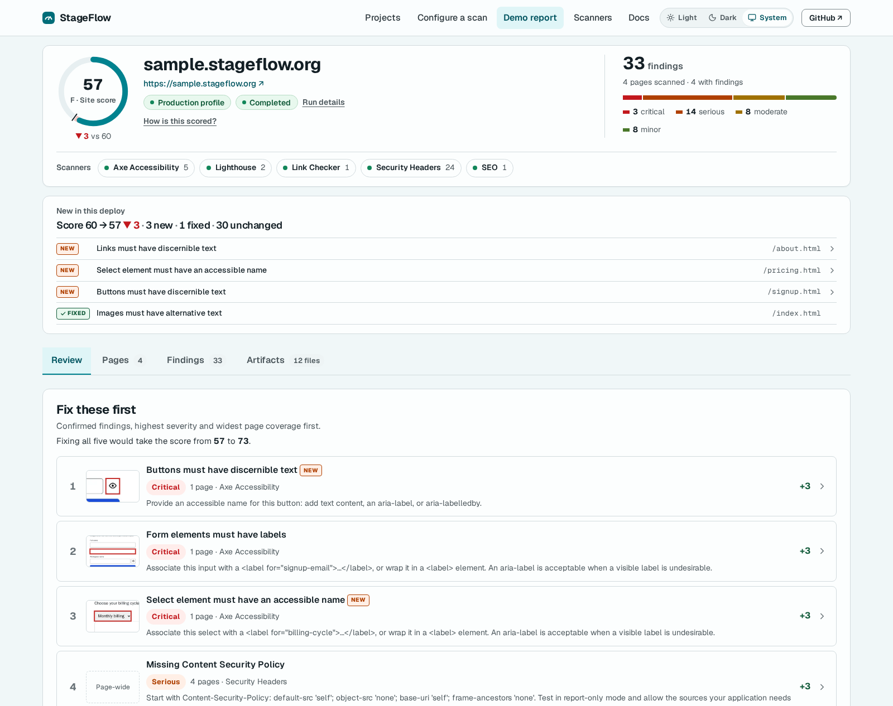
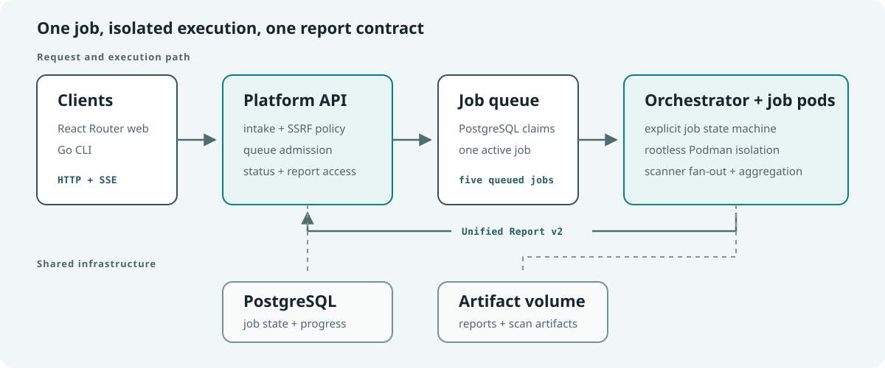

# StageFlow

[](https://github.com/mattboback/stageflow/actions/workflows/ci.yml)
[](LICENSE)

**See what a website release broke, fixed or left unchanged.**

StageFlow audits a deployed website, saves a report and compares later releases with a reviewed baseline. It combines accessibility, SEO, security-header and link checks in one report, with screenshot annotations and concrete fix guidance.

[Try StageFlow](https://stageflow.org) · [Explore the sample report](https://stageflow.org/demo) · [Install the CLI](docs/cli.md) · [Read the architecture](docs/architecture.md)



## What it does

1. **Scan a deployment.** Submit public URLs in the browser, use the CLI, or scan a static build with a self-hosted API.
2. **Review the evidence.** See issues by page and scanner, inspect screenshot annotations and follow fix guidance.
3. **Compare the next release.** Save a baseline, identify new and fixed findings, and use the CLI to fail a release gate on regressions.

Five scanners run in isolated containers: axe for accessibility; Lighthouse for accessibility, best practices and SEO; and StageFlow's SEO, security-header and link checks. Reports distinguish scan failures and incomplete coverage from findings, so missing evidence does not silently become a clean pass.

## Quick start

### Browser

Open [stageflow.org](https://stageflow.org), enter a public URL and start a scan. No account is required. The [sample report](https://stageflow.org/demo) shows a before-and-after comparison without waiting for a scan. [Projects](https://stageflow.org/projects) keep saved runs and baselines in your browser.

Hosted scans accept up to 25 public URLs. Hosted scan records and report files expire 24 hours after completion; save reports you want to keep. Private targets and ZIP uploads use a [self-hosted deployment](docs/self-hosting.md).

### CLI

Download a binary and its checksums from [GitHub Releases](https://github.com/mattboback/stageflow/releases), or install with Go:

```bash
go install github.com/mattboback/stageflow/clients/cli/cmd/stageflow@latest
stageflow scan https://example.com
```

The CLI uses the hosted API by default. See the [CLI guide](docs/cli.md) for baseline comparisons, saved projects, exit codes and the composite GitHub Action.

## Architecture

The stack combines a **Go API and orchestrator**, a **Node.js/TypeScript scanner runtime with Playwright**, a **React Router web client**, and a **PostgreSQL job queue**. Rootless Podman isolates each scan.



The [architecture guide](docs/architecture.md) explains service boundaries, job recovery, report contracts and coverage-aware comparisons. These are useful starting points when reading the implementation:

| Follow this behavior                     | Start here                                                                              |
| ---------------------------------------- | --------------------------------------------------------------------------------------- |
| Accept a scan and validate its targets   | [API intake](services/platform-api/internal/api/handlers_jobs_url_submit.go)            |
| Recover and advance a durable job        | [Orchestrator reconciliation](services/orchestrator/internal/orchestrator/reconcile.go) |
| Launch an isolated scan                  | [Podman job runtime](services/orchestrator/internal/podman/job_runtime.go)              |
| Decide whether a finding is new or fixed | [Report comparison](libs/go/diff/)                                                      |
| Render the report and its evidence       | [Web report route](clients/web/app/routes/scan-report.tsx)                              |

## Repository layout

| Path                                  | Responsibility                                                    |
| ------------------------------------- | ----------------------------------------------------------------- |
| [clients/](clients/)                  | Web app and Go CLI                                                |
| [services/](services/)                | Platform API, orchestrator, archive extractor and scanner runtime |
| [libs/](libs/)                        | Shared contracts, generated types and Go libraries                |
| [internal/](internal/)                | Repository-internal storage and archive support                   |
| [infra/](infra/)                      | Compose, Quadlet templates and runtime image tooling              |
| [qa/](qa/)                            | Full-stack regression scripts and fixtures                        |
| [devtools/](devtools/)                | Contract generation, quality checks and release tooling           |
| [docs/](docs/) and [assets/](assets/) | Guides, architecture diagram and screenshots                      |

## Self-hosting

StageFlow supports rootless Podman. The [self-hosting guide](docs/self-hosting.md) covers prerequisites, local startup, private targets and public deployment configuration.

## Development

Read [CONTRIBUTING.md](CONTRIBUTING.md) for setup, focused checks, the full quality gate and how to update generated files. The repository already checks formatting, types, tests, contract drift and production dead code.

## Security and privacy

Read [SECURITY.md](SECURITY.md) for private vulnerability reporting, retention, authentication handling and the container/network trust boundaries. Use a controlled self-hosted deployment and throwaway test accounts for authenticated scans.

## License

StageFlow is released under the [MIT License](LICENSE).
