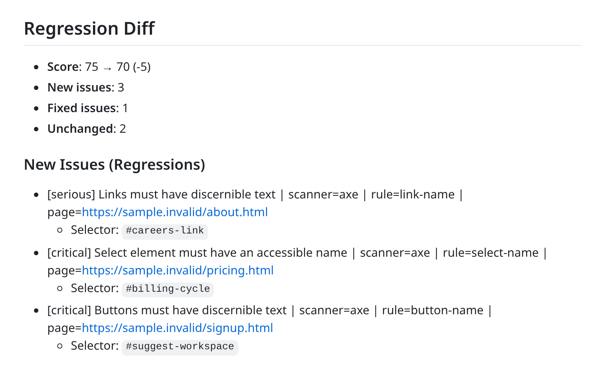

# CLI and automation

[Overview](../README.md) · [Self-hosting](self-hosting.md) · [Security](../SECURITY.md)

Use the CLI to save reports, compare deployments and gate a release on new findings. The CLI calls a running StageFlow API; the hosted API is the default.

## Install

Download the archive for your platform from [GitHub Releases](https://github.com/mattboback/stageflow/releases) and verify it against `checksums.txt`, or install with:

```bash
go install github.com/mattboback/stageflow/clients/cli/cmd/stageflow@latest
stageflow version
```

Scan a public URL, keep a reviewed report as a baseline, and diff later deployments:

```bash
stageflow scan https://preview.example.com --profile staging --format json --max-issues 0 > baseline.json

# After deploying a change:
stageflow scan https://preview.example.com --profile staging --format json --max-issues 0 > current.json
stageflow diff baseline.json current.json --fail-on-new=any \
  --format markdown > comparison.md
```

The diff exits `1` when a release adds a finding. Review `comparison.md` locally, or append the Markdown to `$GITHUB_STEP_SUMMARY` in a GitHub Actions step. The step-summary output looks like this:



## CI

The repository ships a composite action. Deploy a public preview first, then compare it with a complete, reviewed baseline:

```yaml
- uses: actions/checkout@v7
# Deploy a public preview using your hosting provider before this step.
- uses: mattboback/stageflow@v1.0.0
  with:
    baseline: qa/stageflow-baseline.json
    target: https://preview.example.com
    profile: staging
```

Set `STAGEFLOW_API_URL` for a self-hosted API. `STAGEFLOW_API_KEY` is optional for public hosted targets. The action fails on new findings and incomplete coverage.

## CLI commands

| Command                                                   | Use it for                                                 |
| --------------------------------------------------------- | ---------------------------------------------------------- |
| `stageflow check --project project.json --output run-001` | Repeat a saved browser project and compare its baseline    |
| `stageflow scan <url...>`                                 | One-off public or private URL scans                        |
| `stageflow scan <dir-or-zip>`                             | Static build uploads to a self-hosted API                  |
| `stageflow diff baseline.json current.json`               | Compare a saved baseline with a current scan               |
| `stageflow report <job-id>`                               | Fetch a saved report                                       |
| `stageflow discover <url>`                                | Discover pages before choosing what to scan                |
| `stageflow scanners`                                      | List available scanners                                    |
| `stageflow auth capture`                                  | Capture Playwright storage state for an authenticated scan |
| `stageflow completion <shell>`                            | Shell completion for bash, zsh, fish or PowerShell         |

Use `stageflow --help` and `stageflow <command> --help` for exact flags. Exit codes are stable: `0` passes the selected gates, `1` means a finding or regression tripped a gate, and `2` means an error or incomplete scanner coverage. Reports with partial coverage always exit `2` unless the comparison explicitly allows partial coverage.

## Authenticated scans

See [authenticated scanning](../SECURITY.md#authenticated-scanning) for credential handling and the capture commands. Use a controlled self-hosted deployment for private targets and test accounts.
